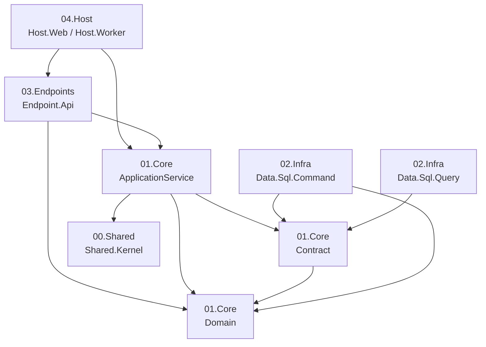
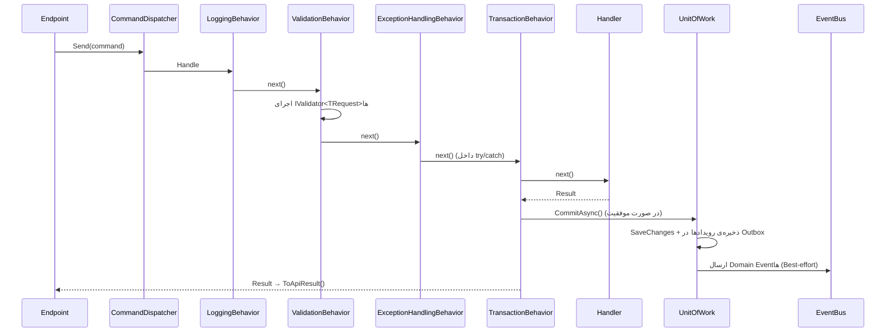

# پوشته (Poshteh)

**پوشته** یک چارچوب (Framework) سبک برای ساخت سرویس‌های .NET بر پایه‌ی **DDD**، **CQRS** و **معماری لایه‌ای / Clean Architecture** است. هدف آن فراهم کردن اسکلتی یکدست برای مدل دامنه‌ی غنی، Command/Query Dispatcher با Pipeline Behavior، Unit of Work با **Transactional Outbox**، نگاشت یکسان `Result` به پاسخ HTTP و بومی‌سازی پیام‌های خطا است؛ بدون وابستگی به کتابخانه‌هایی مثل MediatR.

| مشخصه | مقدار |
|---|---|
| نسخه‌ی فعلی | `10.0.1` |
| Target Framework | `net10.0` |
| SDK | `10.0.302` (طبق [global.json](Framwrok/global.json)) |
| ORM | Entity Framework Core 10 (SQL Server، PostgreSQL، و هر Provider رابطه‌ای دیگر) |
| مدیریت پکیج | Central Package Management ([Directory.Packages.props](Framwrok/Directory.Packages.props)) |

---

## فهرست

- [ویژگی‌ها](#ویژگیها)
- [ساختار مخزن](#ساختار-مخزن)
- [معماری و جهت وابستگی‌ها](#معماری-و-جهت-وابستگیها)
- [شروع سریع](#شروع-سریع)
- [ساخت اپلیکیشن جدید با قالب](#ساخت-اپلیکیشن-جدید-با-قالب)
- [راهنمای استفاده](#راهنمای-استفاده)
- [جریان یک Command](#جریان-یک-command)
- [ساخت، تست و بسته‌بندی](#ساخت-تست-و-بستهبندی)
- [وضعیت فعلی پروژه](#وضعیت-فعلی-پروژه)

---

## ویژگی‌ها

- **مدل دامنه‌ی غنی** — `AggregateRoot`، `BaseEntity`، `ValueObject`، `Enumeration`، `StronglyTypedId<T>`، `Specification<T>` و `DomainEvent`.
- **الگوی Result** — `Result` / `Result<T>` و `Error` با کد پایدار، به‌جای پرتاب Exception برای خطاهای کسب‌وکاری.
- **CQRS بدون وابستگی خارجی** — `ICommandDispatcher` و `IQueryDispatcher` با ثبت خودکار Handlerها از طریق Assembly Scanning.
- **Pipeline Behaviorها** — Logging، Validation، Exception Handling و Transaction به‌صورت پیش‌فرض؛ قابل گسترش با Behaviorهای سفارشی.
- **Unit of Work + Transactional Outbox** — رویدادهای دامنه در همان تراکنش تغییر Aggregate در جدول Outbox ذخیره می‌شوند (همراه با `TraceId`/`SpanId`).
- **Domain Event Bus درون‌پردازشی** — پس از Commit موفق، رویدادها به `IDomainEventHandler<T>`ها ارسال می‌شوند (Best-effort؛ خطای Handler تراکنش را برنمی‌گرداند).
- **جداسازی سمت نوشتن و خواندن** — `BaseCommandDbContext` / `CommandRepository<T>` در برابر `BaseQueryDbContext` / `ReadRepository<T>` (بدون Tracking).
- **لایه‌ی HTTP یکدست** — تبدیل `Result` به `ProblemDetails` با کد وضعیت مناسب، `GlobalExceptionHandler` و `BaseController`.
- **بومی‌سازی پیام‌ها** — مبتنی بر فایل‌های `.resx` با تفکیک مالکیت کلیدها بر اساس پیشوند (مثلاً `Order.`) و اعتبارسنجی پیکربندی در زمان راه‌اندازی.
- **ابزارهای مشترک** — `IClock` و `ICorrelationContextAccessor` در `Shared.Kernel`.

---

## ساختار مخزن

```text
Poshteh/
├── Framwrok/                       # کد اصلی چارچوب
│   ├── Poshteh.slnx                # Solution
│   ├── Directory.Build.props       # تنظیمات مشترک Build و نسخه‌گذاری پکیج
│   ├── Directory.Packages.props    # نسخه‌ی مرکزی پکیج‌های NuGet
│   ├── src/
│   │   ├── 00.Shared/   Poshteh.Shared.Kernel
│   │   ├── 01.Core/     Poshteh.Core.Domain
│   │   │                Poshteh.Core.Contract
│   │   │                Poshteh.Core.ApplicationService
│   │   │                Poshteh.Core.ModuleKernel
│   │   ├── 02.Infra/    Poshteh.Infra.Data.Sql.Command
│   │   │                Poshteh.Infra.Data.Sql.Query
│   │   ├── 03.Endpoints/Poshteh.Endpoint.Api
│   │   ├── 04.Host/     Poshteh.Host.Web, Poshteh.Host.Worker
│   │   └── 05.Quality/  Poshteh.Testing.Kit
│   ├── samples/
│   │   └── Poshteh.Sample.Ordering # نمونه‌ی کامل سفارش (Minimal API + SQLite)
│   ├── tests/                      # UnitTests (+ جایگاه Architecture/Contract/Integration)
│   ├── templates/
│   │   └── Poshteh.Templates       # قالب dotnet new poshteh
│   └── tools/                      # رزرو شده برای CLI و Analyzerها
└── Extentions/
    └── Poshteh.Identity            # رزرو شده برای افزونه‌ی Identity
```

### پکیج‌ها

| پروژه | مسئولیت |
|---|---|
| `Poshteh.Shared.Kernel` | ابزارهای بدون وابستگی: `IClock`، `CorrelationContext` |
| `Poshteh.Core.Domain` | هسته‌ی مدل دامنه: `AggregateRoot`، `BaseEntity`، `ValueObject`، `Result`/`Error`، `IUnitOfWork`، `Specification` |
| `Poshteh.Core.Contract` | پورت‌ها: `ICommandRepository<T>`، `IReadRepository<T>`، `IDomainEventDispatcher`، `IMessageLocalizer`، Outbox |
| `Poshteh.Core.ApplicationService` | Dispatcherها، Pipeline Behaviorها، Event Bus درون‌پردازشی، بومی‌سازی |
| `Poshteh.Core.ModuleKernel` | قرارداد ثبت ماژول‌ها (در دست طراحی) |
| `Poshteh.Infra.Data.Sql.Command` | آداپتور EF Core سمت نوشتن: `BaseCommandDbContext`، `CommandRepository<T>`، `UnitOfWork`، Outbox |
| `Poshteh.Infra.Data.Sql.Query` | آداپتور EF Core سمت خواندن: `BaseQueryDbContext`، `ReadRepository<T>` |
| `Poshteh.Endpoint.Api` | نگاشت `Result` به HTTP، `GlobalExceptionHandler`، `BaseController`، Request Localization |
| `Poshteh.Host.Web` / `Poshteh.Host.Worker` | Composition Root نمونه برای وب و پردازش پس‌زمینه |
| `Poshteh.Testing.Kit` | پایه‌ی Contract Test و پیاده‌سازی‌های In-memory (در دست طراحی) |

---

## معماری و جهت وابستگی‌ها

وابستگی‌ها همیشه **به سمت داخل** (به سوی Domain) هستند. Core هیچ اطلاعی از EF Core یا ASP.NET Core ندارد و تنها از طریق پورت‌های `Core.Contract` با Infra ارتباط می‌گیرد.



---

## شروع سریع

### پیش‌نیازها

- [.NET SDK 10.0.302](https://dotnet.microsoft.com/download) یا نسخه‌ی Patch بالاتر
- (اختیاری) SQL Server یا PostgreSQL — نمونه‌ی موجود با SQLite اجرا می‌شود و به پایگاه‌داده‌ی جداگانه نیاز ندارد.

### اجرای نمونه‌ی Ordering

```bash
cd Framwrok
dotnet build Poshteh.slnx
dotnet run --project samples/Poshteh.Sample.Ordering
```

سپس با فایل [Poshteh.Sample.Ordering.http](Framwrok/samples/Poshteh.Sample.Ordering/Poshteh.Sample.Ordering.http) یا `curl` درخواست بفرستید:

```bash
curl -X POST http://localhost:5080/orders \
  -H "Content-Type: application/json" \
  -d '{
        "customerName": "Ada Lovelace",
        "items": [
          { "productName": "Mechanical Keyboard", "unitPrice": 120.50, "quantity": 1 },
          { "productName": "USB-C Hub",          "unitPrice": 35.00,  "quantity": 2 }
        ]
      }'

curl http://localhost:5080/orders/1
```

پس از ثبت سفارش، `OrderCreatedEventHandler` یک لاگ ثبت می‌کند. این لاگ نشان می‌دهد زنجیره‌ی Commit → Domain Event Dispatcher → Event Bus → Handler کار می‌کند.

---

## ساخت اپلیکیشن جدید با قالب

با قالب `poshteh` می‌توانید یک Solution لایه‌ای کامل بسازید که به پکیج‌های `Poshteh.*` ارجاع می‌دهد. این Solution یک Web API مستقل و قابل اجرا است که این‌ها را دارد:
- لایه‌های Domain، Contract، ApplicationService و Infra (سمت نوشتن و خواندن)
- Controllerها و Swagger
- نمونه‌ی کامل CRUD با فیلتر و صفحه‌بندی
- تست‌های واحد

با `--ModularMonolith` راه‌اندازی برنامه به پروژه‌ی جدای Host.Web منتقل می‌شود:

```powershell
dotnet new install Framwrok/templates/Poshteh.Templates/content/PoshtehStarter
dotnet new poshteh -n Mahtab --PoshtehFeed "D:\NuGets"                    # Endpoint.Api خودش اجرا می‌شود
dotnet new poshteh -n Shop --ModularMonolith --PoshtehFeed "D:\NuGets"    # Host.Web جدا
```

جزئیات پارامترها، بسته‌بندی و نگهداری قالب در [Poshteh.Templates/README.md](Framwrok/templates/Poshteh.Templates/README.md) آمده است.

---

## راهنمای استفاده

مثال‌های زیر از نمونه‌ی [Poshteh.Sample.Ordering](Framwrok/samples/Poshteh.Sample.Ordering/) گرفته شده‌اند.

### ۱. تعریف Aggregate

Invariantها داخل Aggregate بررسی می‌شوند و خطا به‌شکل `Result.Failure` برمی‌گردد:

```csharp
public sealed class Order : AggregateRoot
{
    private readonly List<OrderItem> _items = [];

    public string CustomerName { get; private set; } = string.Empty;
    public IReadOnlyList<OrderItem> Items => _items;

    public static Result<Order> Create(string customerName, IReadOnlyCollection<(string, decimal, int)> items)
    {
        if (string.IsNullOrWhiteSpace(customerName))
            return Result.Failure<Order>(new Error("Order.CustomerNameRequired"));

        var order = new Order(customerName.Trim());
        // ... افزودن اقلام
        order.AddDomainEvent(new OrderCreatedEvent(order.CustomerName, order._items.Count, order.TotalAmount));
        return order;
    }
}
```

### ۲. Command و Handler

```csharp
public sealed record CreateOrderCommand(string CustomerName, IReadOnlyCollection<CreateOrderItem> Items)
    : ICommand<long>;

public sealed class CreateOrderCommandHandler(ICommandRepository<Order> orders)
    : ICommandHandler<CreateOrderCommand, long>
{
    public async Task<Result<long>> Handle(CreateOrderCommand command, CancellationToken ct = default)
    {
        var orderResult = Order.Create(command.CustomerName, /* items */);
        if (orderResult.IsFailure)
            return Result.Failure<long>(orderResult.Error);

        await orders.AddAsync(orderResult.Value, ct);
        return orderResult.Value.Id;
    }
}
```

> `TransactionBehavior` پس از موفقیت هر `ICommand`، اگر `IUnitOfWork` ثبت شده باشد، `CommitAsync` را خودش صدا می‌زند.

### ۳. Query

```csharp
public sealed record GetOrderByIdQuery(long OrderId) : IQuery<OrderDto>;

public sealed class GetOrderByIdQueryHandler(IReadRepository<OrderReadModel> orders)
    : IQueryHandler<GetOrderByIdQuery, OrderDto>
{
    public async Task<Result<OrderDto>> Handle(GetOrderByIdQuery query, CancellationToken ct = default)
    {
        var order = await orders.GetByIdAsync(query.OrderId, ct);
        return order is null
            ? Result.Failure<OrderDto>(new Error("Order.NotFound"))
            : new OrderDto(/* ... */);
    }
}
```

### ۴. Domain Event Handler

```csharp
public sealed class OrderCreatedEventHandler(ILogger<OrderCreatedEventHandler> logger)
    : IDomainEventHandler<OrderCreatedEvent>
{
    public Task HandleAsync(OrderCreatedEvent @event, CancellationToken ct = default)
    {
        logger.LogInformation("Order created for {CustomerName}", @event.CustomerName);
        return Task.CompletedTask;
    }
}
```

### ۵. Persistence

```csharp
public sealed class OrderingDbContext(DbContextOptions<OrderingDbContext> options)
    : BaseCommandDbContext(options)
{
    public DbSet<Order> Orders => Set<Order>();

    protected override void OnModelCreating(ModelBuilder modelBuilder)
    {
        base.OnModelCreating(modelBuilder); // جدول Outbox را پیکربندی می‌کند
        modelBuilder.ApplyConfiguration(new OrderConfiguration());
    }
}

// CommandRepository<T> انتزاعی است؛ هر Aggregate مخزن مخصوص خودش را دارد.
public sealed class OrderCommandRepository(BaseCommandDbContext dbContext)
    : CommandRepository<Order>(dbContext);
```

### ۶. Composition Root (`Program.cs`)

```csharp
var builder = WebApplication.CreateBuilder(args);

// سمت نوشتن — یکی از این سه:
builder.Services.AddSqlCommandPersistence<OrderingDbContext>(o => o.UseSqlite(connectionString));
// builder.Services.AddSqlServerCommandPersistence<OrderingDbContext>(connectionString);
// builder.Services.AddPostgresCommandPersistence<OrderingDbContext>(connectionString);

// سمت خواندن (اختیاری):
// builder.Services.AddSqlServerQueryPersistence<OrderingQueryDbContext>(connectionString);

builder.Services.AddScoped<ICommandRepository<Order>, OrderCommandRepository>();

// Dispatcherها، Behaviorها، Event Bus و اسکن Handlerها
builder.Services.AddApplicationService(typeof(CreateOrderCommandHandler).Assembly);

// Controllerها، ProblemDetails، GlobalExceptionHandler و بومی‌سازی
builder.Services.AddEndpointApi();

var app = builder.Build();
app.UseExceptionHandler();

app.MapGet("/orders/{id:long}", async (long id, IQueryDispatcher dispatcher, IMessageLocalizer localizer, CancellationToken ct) =>
    (await dispatcher.Send(new GetOrderByIdQuery(id), ct)).ToApiResult(localizer));

app.Run();
```

اگر از Controller استفاده می‌کنید، از `BaseController` ارث ببرید و `ExecuteCreate` / `ExecuteUpdate` / `ExecuteDelete` / `ExecuteQuery` را صدا بزنید. در این حالت `app.MapControllers()` را هم اضافه کنید.

### ۷. بومی‌سازی پیام‌های خطا

```csharp
builder.Services.AddPoshtehLocalization(options =>
{
    options.DefaultCultureName = "fa-IR";
    options.SupportedCultureNames.Add("fa-IR");
    options.SupportedCultureNames.Add("en-US");
});

// کلیدهایی که با "Order." شروع می‌شوند فقط در OrderMessages.resx جست‌وجو می‌شوند.
builder.Services.AddPoshtehMessageResources<OrderMessages>("Order.");

// ...
app.UsePoshtehRequestLocalization(); // پیکربندی را هنگام شروع برنامه اعتبارسنجی می‌کند
```

- ثبت دو Provider با پیشوند یکسان، یا نبودن Manifest منبع، **در زمان راه‌اندازی** خطا می‌دهد، نه در اولین درخواست.
- متن داخلی Exceptionها هرگز به کلاینت برگردانده نمی‌شود. خطاهای پیش‌بینی‌نشده به کلید امن `Common.UnexpectedError` نگاشت می‌شوند.

### نگاشت کد خطا به وضعیت HTTP

`ToApiResult` بر اساس محتوای `Error.Code` کد وضعیت را انتخاب می‌کند و پاسخ را به‌صورت `ProblemDetails` (با فیلد `code`) برمی‌گرداند:

| کد خطا شامل… | وضعیت HTTP |
|---|---|
| — (موفق، `Result<T>`) | `200 OK` |
| — (موفق، `Result`) | `204 No Content` |
| `NotFound` | `404 Not Found` |
| `Conflict` | `409 Conflict` |
| `Validation` یا `DomainException` | `422 Unprocessable Entity` |
| سایر موارد | `400 Bad Request` |

---

## جریان یک Command

Behaviorها به ترتیب ثبت، از بیرون به داخل اجرا می‌شوند:



برای افزودن اعتبارسنجی، کافی است `IValidator<TCommand>` را پیاده‌سازی و در DI ثبت کنید. Behaviorهای سفارشی (`IPipelineBehavior<,>`) هم در Assemblyهای ارسال‌شده به `AddApplicationService` به‌صورت خودکار پیدا و ثبت می‌شوند.

---

## ساخت، تست و بسته‌بندی

همه‌ی دستورها از پوشه‌ی `Framwrok/` اجرا می‌شوند:

```bash
# ساخت
dotnet build Poshteh.slnx

# اجرای تست‌ها
dotnet test Poshteh.slnx

# تولید پکیج‌های NuGet
dotnet pack Poshteh.slnx -c Release
```

- فقط پروژه‌هایی که `IsPackable=true` دارند (پروژه‌های `src/` به‌جز Hostها، و `Poshteh.Templates`) پکیج می‌شوند.
- نسخه از `PoshtehVersion` خوانده می‌شود (پیش‌فرض `10.0.1`). برای تغییر آن: `dotnet pack -p:PoshtehVersion=10.0.2`.
- مسیر خروجی پکیج‌ها:
  - در Windows، اگر درایو `D:` وجود داشته باشد: `D:\NuGets`
  - در غیر این صورت: `Framwrok/artifacts/packages`
  - برای تغییر مسیر: `-p:PoshtehPackageOutputPath=<path>`

---

## وضعیت فعلی پروژه

| بخش | وضعیت |
|---|---|
| Domain، Contract، ApplicationService | ✅ پیاده‌سازی شده |
| Infra (Command / Query) | ✅ پیاده‌سازی شده |
| Endpoint.Api | ✅ پیاده‌سازی شده |
| نمونه‌ی Ordering | ✅ قابل اجرا (SQLite) |
| Unit Test | 🟡 فقط `Core.ApplicationService` (بومی‌سازی و مدیریت Exception) |
| ارسال Outbox توسط Worker پس‌زمینه | ⏳ پیاده‌سازی نشده؛ `Host.Worker` فعلاً فقط جایگاه است |
| `Core.ModuleKernel` / `Testing.Kit` | ⏳ فقط پروژه‌ی خالی |
| Architecture / Contract / Integration Tests | ⏳ رزرو شده |
| قالب `dotnet new poshteh` (`Poshteh.Templates`) | ✅ پیاده‌سازی شده |
| ابزارهای CLI | ⏳ رزرو شده |
| `Extentions/Poshteh.Identity` | ⏳ رزرو شده |
